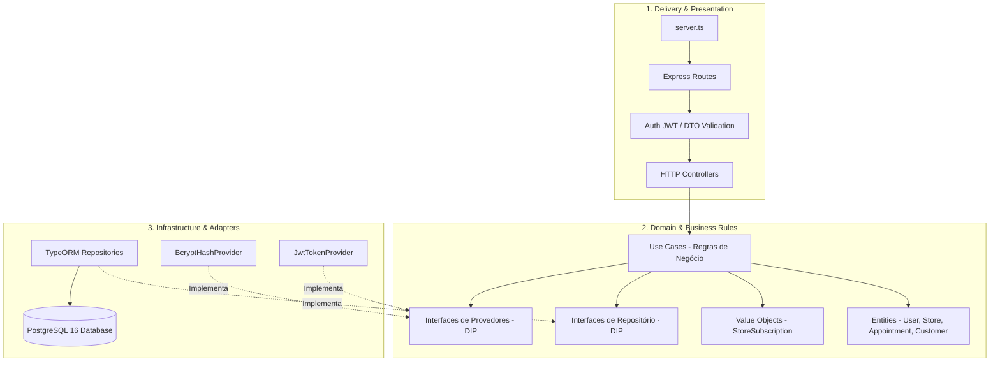
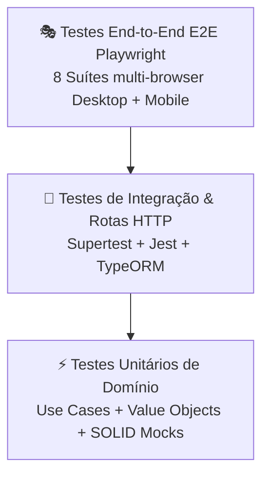

# Catálogo Express

[](.github/workflows/test-pipeline.yml)
[](backend/)
[](front/)
[](https://nodejs.org/)
[](https://react.dev/)
[](https://www.typescriptlang.org/)
[](https://www.postgresql.org/)
[](#-licença)

> Plataforma completa de catálogo digital interativo, vitrine virtual multi-nicho e gestão operacional de pedidos e agendamentos com envio direto para o WhatsApp, construída com **Clean Architecture**, **SOLID**, **React 19**, **TypeScript** e **PostgreSQL**.

---

## 📑 Sumário

- [Visão Geral e Proposta de Valor](#-visão-geral-e-proposta-de-valor)
- [Funcionalidades Principais](#-funcionalidades-principais)
- [Arquitetura do Sistema](#-arquitetura-do-sistema)
- [Estrutura do Repositório](#-estrutura-do-repositório)
- [Início Rápido (Ambiente de Desenvolvimento)](#-início-rápido-ambiente-de-desenvolvimento)
  - [Pré-requisitos](#pré-requisitos)
  - [1. Subir o Banco de Dados (PostgreSQL via Docker)](#1-subir-o-banco-de-dados-postgresql-via-docker)
  - [2. Configurar e Executar o Backend](#2-configurar-e-executar-o-backend)
  - [3. Configurar e Executar o Frontend](#3-configurar-e-executar-o-frontend)
- [🧪 Estratégia Completa de Testes Automatizados & Qualidade](#-estratégia-completa-de-testes-automatizados--qualidade)
  - [Visão Geral da Pirâmide de Testes](#visão-geral-da-pirâmide-de-testes)
  - [1. Testes do Backend (Jest + ts-jest)](#1-testes-do-backend-jest--ts-jest)
  - [2. Testes End-to-End do Frontend (Playwright)](#2-testes-end-to-end-do-frontend-playwright)
  - [3. Especificações BDD (Gherkin) & Page Object Model (POM)](#3-especificações-bdd-gherkin--page-object-model-pom)
  - [4. Integração Contínua (CI/CD Pipeline)](#4-integração-contínua-cicd-pipeline)
- [📡 Principais Endpoints da API REST](#-principais-endpoints-da-api-rest)
- [📚 Documentação Complementar & Manuais](#-documentação-complementar--manuais)
- [🛠️ Tecnologias Utilizadas](#️-tecnologias-utilizadas)
- [📄 Licença](#-licença)

---

## 🌟 Visão Geral e Proposta de Valor

O **Catálogo Express** foi desenvolvido para libertar estabelecimentos comerciais e prestadores de serviços de taxas abusivas cobradas por marketplaces e plataformas intermediárias tradicionais:

- 🚀 **Venda Direta via WhatsApp:** Pedidos e solicitações formatados e totalizados chegam diretamente no WhatsApp da loja, prontos para faturamento e produção.
- 🎨 **Multi-Nicho Instantâneo:** Adaptação inteligente de termos, paletas de cores harmônicas e campos específicos (Restaurantes, Hamburguerias, Pizzarias, Moda, Cosméticos, Pet Shops, Clínicas, Salões de Beleza e Serviços).
- 🏢 **Multi-Tenant Seguro (RBAC):** Suporte nativo a dezenas de lojas isoladas, cada uma com seus próprios produtos, clientes, configurações e esteira de atendimento.
- 📱 **Progressive Web App (PWA):** Instalação com 1 clique na tela inicial de clientes e atendentes, operando com cache local e alta velocidade.
- 📅 **Agendamento Inteligente & Google Calendar:** Sincronização via OAuth 2.0 direta na Google Agenda do lojista e lembretes automáticos via Evolution API.

---

## ⚡ Funcionalidades Principais

| Módulo | Descrição |
| :--- | :--- |
| **Vitrine Pública do Cliente** | Catálogo responsivo com filtros por categoria, busca textual, fotos de alta qualidade, adicionais/opcionais, carrinho interativo e checkout com envio ao WhatsApp. |
| **Onboarding Wizard** | Assistente de configuração que coloca uma loja no ar em menos de 3 minutos (seleção de nicho, cores com verificação de contraste e inserção de produtos). |
| **Esteira Kanban de Pedidos** | Gestão visual de pedidos em tempo real por colunas (*Recebidos*, *Em Preparo*, *Prontos*, *Entregues*) com temporizador de permanência por status. |
| **Módulo de Agendamentos** | Grade de horários públicos, regras de intervalo/duração, sincronização OAuth 2.0 com Google Agenda e disparos automáticos de lembretes aos clientes. |
| **Gatekeeper de Clientes & Pets** | Cadastro e autenticação de tutores/clientes com ficha técnica para múltiplos animais (espécie, raça, porte, cuidados especiais e transporte). |
| **Painel Superadmin** | Gestão global de lojas, duplicação rápida, controle de planos (Mensal, Trimestral, Semestral, Anual) e ativação/suspensão de assinaturas. |
| **Editor com Rich Text (Lexical)** | Descrições ricas com formatação avançada (negrito, itálico, listas, links) utilizando a engine Lexical do Facebook. |
| **Multicanal Híbrido** | Opção para direcionar o cliente a canais externos (Mercado Livre, Shopee, Amazon) com rastreamento analítico de cliques. |

---

## 🏛️ Arquitetura do Sistema

O projeto adota uma arquitetura em duas grandes frentes complementares:

### 1. Backend (Clean Architecture & SOLID)



- **Independência de Frameworks:** Os Casos de Uso dependem exclusivamente de interfaces (`DIP`), permitindo testes unitários com repositórios e provedores mockados em memória.
- **Validação Segura:** DTOs rigorosamente validados com `class-validator` e `class-transformer` antes de atingir as camadas internas.

### 2. Frontend (React 19 + Vite + PWA + Dexie)

- **Code-Splitting Sob Demanda:** Carregamento otimizado com `React.lazy` e `Suspense` em cada módulo (Admin, Vitrine, Superadmin, Onboarding, Pedidos, Agendamentos).
- **Offline-First & Cache:** Persistência em IndexedDB através do `Dexie`, garantindo resiliência de dados e rapidez na experiência do usuário.
- **Design System Tailored:** Tailwind CSS v4, tipografia moderna e temas com conformidade WCAG de acessibilidade.

---

## 📁 Estrutura do Repositório

```text
app_express/
├── backend/                              # Servidor Node.js + Express + TypeORM + PostgreSQL
│   ├── docker-compose.yml                # Contêiner PostgreSQL 16 com volume persistente
│   ├── jest.config.cjs                   # Configuração Jest com suporte a ESM/TypeScript
│   ├── src/
│   │   ├── config/                       # Variáveis de ambiente e configuração de autenticação
│   │   ├── delivery/http/                # Controllers, Middlewares, Rotas Express e Servidor
│   │   ├── domain/                       # Entidades, DTOs, Use Cases, Value Objects e Contratos
│   │   ├── infrastructure/               # TypeORM DataSource, Entidades de Banco, Seeds e Provedores
│   │   └── app.ts                        # Injeção de dependências e inicialização do Express
│   └── package.json
│
├── front/                                # Single Page Application React 19 + Vite 6 + Tailwind CSS v4
│   ├── playwright.config.ts              # Configuração Playwright E2E (Desktop e Mobile)
│   ├── src/
│   │   ├── components/                   # Componentes modulares (admin, auth, calendar, public, ui)
│   │   ├── context/                      # Contextos React (CatalogContext, CustomerAuthContext)
│   │   ├── db/                           # Esquema Dexie IndexedDB local
│   │   └── index.css                     # Estilos base e temas Tailwind CSS v4
│   ├── tests/
│   │   ├── e2e/                          # 8 Suítes completas de testes E2E Playwright
│   │   ├── features/                     # Especificações BDD em formato Gherkin (.feature)
│   │   └── pages/                        # Page Object Models (POM) para automação
│   └── package.json
│
├── docs/                                 # Manuais e documentações arquiteturais
│   ├── DOCUMENTACAO_FUNCIONAL.md         # Manual de funcionalidades de negócio e regras operacionais
│   └── GUIA_PRE_DEPLOY.md                # Procedimento operacional de 5 fases para produção
│
├── .github/workflows/
│   └── test-pipeline.yml                 # Pipeline CI automatizada (Playwright + Jest)
└── README.md                             # Este manual
```

---

## ⚡ Início Rápido (Ambiente de Desenvolvimento)

### Pré-requisitos
- **Node.js**: `v20.x` ou superior
- **Docker & Docker Compose**: Para execução do PostgreSQL
- **Git** e **npm** (ou **bun**)

---

### 1. Subir o Banco de Dados (PostgreSQL via Docker)

Na raiz da pasta `backend/`:

```bash
cd backend
docker compose up -d
```
> O contêiner iniciará o PostgreSQL 16 na porta `5432` com volume de dados persistente.

---

### 2. Configurar e Executar o Backend

Ainda na pasta `backend/`:

```bash
# 1. Instalar dependências
npm install

# 2. Configurar variáveis de ambiente
cp .env.example .env

# 3. Executar o Seeder inicial do Superadmin Root (opcional/recomendado)
npx tsx src/infrastructure/database/typeorm/seeds/runSeed.ts

# 4. Iniciar em modo de desenvolvimento (hot-reload via tsx)
npm run dev
```

- **API Base:** `http://localhost:3333`
- **Healthcheck:** `http://localhost:3333/api/health`
- **Credenciais padrão do Superadmin:**
  - **E-mail:** `gabrielvictos152@gmail.com`
  - **Senha:** `123456789`

---

### 3. Configurar e Executar o Frontend

Em um novo terminal, entre na pasta `front/`:

```bash
cd front

# 1. Instalar dependências
npm install

# 2. Iniciar servidor Vite
npm run dev
```

- **Aplicação Web:** `http://localhost:3000`
- O Vite está configurado com proxy transparente direcionando `/api` para `http://localhost:3333/api`.

---

## 🧪 Estratégia Completa de Testes Automatizados & Qualidade

A garantia da qualidade do **Catálogo Express** segue as melhores práticas da engenharia de software com foco em **confiança**, **velocidade** e **cobertura real de cenários de negócio**.

### Visão Geral da Pirâmide de Testes



---

### 1. Testes do Backend (Jest + ts-jest)

O backend possui uma suíte com **6 arquivos de teste e 41 casos de teste automatizados**, cobrindo desde regras matemáticas de assinaturas até endpoints HTTP com controle de acesso RBAC.

#### Executar Testes do Backend:

```bash
cd backend

# Executar todas as suítes de teste
npm test

# Executar testes em modo observador (watch mode)
npx jest --config jest.config.cjs --watch

# Executar com relatório de cobertura de código (coverage)
npx jest --config jest.config.cjs --coverage

# Executar apenas um arquivo de teste específico
npx jest --config jest.config.cjs src/domain/value-objects/StoreSubscription.spec.ts
```

#### Suítes Testadas:

| Suíte de Teste | Camada | O que é testado |
| :--- | :--- | :--- |
| [`StoreSubscription.spec.ts`](backend/src/domain/value-objects/StoreSubscription.spec.ts) | Domínio / Value Object | Cálculo de status ativo, vencendo em breve (<= 5 dias), vencido e transições dos planos (mensal, trimestral, semestral, anual). |
| [`AuthenticateUserUseCase.spec.ts`](backend/src/domain/use-cases/auth/AuthenticateUserUseCase.spec.ts) | Domínio / Caso de Uso | Registro de usuários, prevenção de e-mails duplicados, hash de senha Bcrypt e geração de JWT sem acoplamento a banco de dados. |
| [`data-source.spec.ts`](backend/src/infrastructure/database/typeorm/data-source.spec.ts) | Infraestrutura | Inicialização e integridade da conexão TypeORM com o contêiner PostgreSQL. |
| [`index.spec.ts`](backend/src/delivery/http/routes/index.spec.ts) | HTTP / Apresentação | Rota global de healthcheck (`GET /api/health`) validando status 200 e timestamp ISO. |
| [`store.routes.spec.ts`](backend/src/delivery/http/routes/store.routes.spec.ts) | HTTP / Apresentação | CRUD de lojas, isolamento multi-tenant (lojista só visualiza sua loja), liberação de assinaturas por Superadmin e proteção RBAC. |
| [`auth.routes.spec.ts`](backend/src/delivery/http/routes/auth.routes.spec.ts) | HTTP / Apresentação | Fluxos de `/register`, `/login`, validação de payload com `class-validator`, `/me` e restrição de listagem de usuários apenas a Superadmins. |

---

### 2. Testes End-to-End do Frontend (Playwright)

Os testes de ponta a ponta simulam jornadas de usuários reais em navegadores Desktop e Dispositivos Móveis através do **Playwright**:

- **Navegadores Desktop:** Chromium, Firefox, WebKit (Safari).
- **Emulação Mobile:** Google Pixel 5 (Mobile Chrome) e iPhone 13 (Mobile Safari).
- **Subida Automática:** O Playwright inicia automaticamente o servidor de desenvolvimento (`npm run dev` na porta 3000) caso não esteja em execução.

#### Comandos Disponíveis para Testes E2E:

```bash
cd front

# 1. Executar testes E2E em modo headless (terminal)
npm run test:e2e

# 2. Executar com Interface Visual Interativa (Playwright UI Mode)
npm run test:e2e:ui

# 3. Executar abrindo o navegador com visualização passo a passo (Headed)
npm run test:e2e:headed

# 4. Abrir o relatório HTML completo da última execução
npm run test:e2e:report

# 5. Executar apenas uma suíte E2E específica
npx playwright test tests/e2e/public-catalog-and-checkout.spec.ts
```

#### Suítes E2E Automatizadas:

1. [`public-catalog-and-checkout.spec.ts`](front/tests/e2e/public-catalog-and-checkout.spec.ts): Vitrine pública, adição de itens ao carrinho, modal de detalhes e envio do pedido formatado.
2. [`orders-and-status-clock.spec.ts`](front/tests/e2e/orders-and-status-clock.spec.ts): Movimentação de pedidos na esteira Kanban e relógio de tempo de permanência em cada status.
3. [`auth-and-access.spec.ts`](front/tests/e2e/auth-and-access.spec.ts): Login de lojista e atendente, permissões de rota e logout seguro.
4. [`superadmin-stores.spec.ts`](front/tests/e2e/superadmin-stores.spec.ts): Acesso ao painel global, criação de novas lojas e controle de plano e status de pagamento.
5. [`onboarding-wizard.spec.ts`](front/tests/e2e/onboarding-wizard.spec.ts): Fluxo guiado de configuração inicial de lojas (nichos, paletas e produtos).
6. [`company-and-location.spec.ts`](front/tests/e2e/company-and-location.spec.ts): Edição dos dados da empresa, horários de funcionamento e integração com Google Maps.
7. [`products-and-marketplaces.spec.ts`](front/tests/e2e/products-and-marketplaces.spec.ts): Cadastro de produtos, categorias, variações de preço e links para marketplaces externos.
8. [`dark-mode.spec.ts`](front/tests/e2e/dark-mode.spec.ts): Alternância de tema claro/escuro e persistência da preferência do usuário.

---

### 3. Especificações BDD (Gherkin) & Page Object Model (POM)

A estrutura de testes do frontend segue o padrão internacional **Page Object Model (POM)** aliado a cenários declarativos em formato **BDD (Behavior-Driven Development)**:

#### Page Objects (`front/tests/pages/`):
- `PublicCatalogPage.ts`: Encapsula seletores e ações da vitrine do cliente.
- `PedidosPage.ts`: Abstrai a esteira Kanban e colunas de status.
- `LoginPage.ts`: Abstrai o formulário de login e credenciais.
- `SuperAdminPage.ts`: Abstrai a gestão de tenants e ativação de planos.
- `ProductManagerPage.ts`: Abstrai o cadastro e edição de produtos e fotos.
- `CompanyEditorPage.ts`: Abstrai os dados da loja, WhatsApp e horários.

#### Especificações BDD (`front/tests/features/`):
- `01_autenticacao_e_acesso.feature`: Cenários de autenticação de lojistas e colaboradores.
- `02_gestao_lojas_superadmin.feature`: Cenários de governança de planos e isolamento entre lojas.
- `03_perfil_empresa_e_localizacao.feature`: Regras de geolocalização e presença digital da loja.
- `04_catalogo_produtos_e_marketplaces.feature`: Regras de catálogo e multicanalidade.
- `05_vitrine_publica_e_checkout.feature`: Jornada completa do consumidor até o WhatsApp.

---

### 4. Integração Contínua (CI/CD Pipeline)

O repositório possui uma pipeline automatizada no **GitHub Actions** configurada em [`.github/workflows/test-pipeline.yml`](.github/workflows/test-pipeline.yml), acionada em todo `push` ou `pull_request` nas branches `main`, `master` e `develop`:

```yaml
# Visão resumida dos Jobs da Pipeline:
jobs:
  test-frontend-e2e:
    name: Frontend E2E Tests (Playwright)
    runs-on: ubuntu-latest
    steps:
      - Instala dependências do Frontend (npm ci)
      - Instala os binários do Playwright com dependências do sistema
      - Executa npm run test:e2e
      - Faz upload dos relatórios em caso de falha

  test-backend:
    name: Backend Tests (Jest)
    runs-on: ubuntu-latest
    steps:
      - Instala dependências do Backend (npm ci)
      - Executa npm test com validação estrita
```

---

## 📡 Principais Endpoints da API REST

A API do backend segue o padrão RESTful com respostas estruturadas em JSON:

### 1. Sistema & Saúde
- `GET /api/health` — Status operacional do servidor e timestamp ISO atual.

### 2. Autenticação & Usuários (`/api/auth`)
- `POST /api/auth/register` — Cadastro de novo usuário (`name`, `email`, `password`).
- `POST /api/auth/login` — Autenticação de credenciais, retornando JWT e perfil.
- `GET /api/auth/me` *(Bearer Token)* — Retorna os dados do usuário autenticado.
- `GET /api/auth/users` *(Bearer Token - Superadmin)* — Listagem de todos os usuários da plataforma.

### 3. Lojas & Multi-Tenancy (`/api/stores`)
- `POST /api/stores` *(Bearer Token)* — Criação de nova loja com slug exclusivo.
- `GET /api/stores/:slug` *(Público)* — Retorna dados públicos da loja para a vitrine.
- `PUT /api/stores/:slug` *(Bearer Token)* — Atualização das configurações da loja pelo proprietário.
- `GET /api/stores` *(Bearer Token)* — Listagem isolada (apenas loja do usuário ou todas se Superadmin).
- `DELETE /api/stores/:slug` *(Bearer Token - Superadmin)* — Exclusão permanente de tenant.
- `PATCH /api/stores/:slug/payment` *(Bearer Token - Superadmin)* — Ativação/suspensão de pagamento.
- `PATCH /api/stores/:slug/plan` *(Bearer Token)* — Seleção de plano de assinatura.
- `GET /api/stores/:slug/subscription` *(Bearer Token)* — Status detalhado da assinatura e dias restantes.

---

## 📚 Documentação Complementar & Manuais

Para se aprofundar nas regras de negócio e procedimentos operacionais, consulte os manuais específicos disponíveis na pasta `docs/`:

- 📖 **[Documentação Funcional Completa](docs/DOCUMENTACAO_FUNCIONAL.md):** Manual completo de perfis de acesso, regras de onboarding, vitrine pública, esteira Kanban, multi-tenant e especificidades por nicho.
- 🚀 **[Guia e Checklist Pré-Deploy](docs/GUIA_PRE_DEPLOY.md):** Procedimento Operacional Padrão (POP) em 5 fases (*Prepare*, *Backup*, *Deploy*, *Verify*, *Rollback*), variáveis de ambiente de produção, migrações TypeORM, Nginx e PM2.
- 📅 **[Sincronização Google Agenda via OAuth2](google-agenda-oauth-sync.md):** Especificação da integração com a Google Calendar API para agendamento direto e sem etapas manuais.
- 🐾 **[Cadastro de Clientes & Múltiplos Pets](customer-auth-pets.md):** Arquitetura do módulo de tutores e fichas cadastrais de animais.
- ⏰ **[Cronjob de Lembretes via WhatsApp](appointment-cron-reminder.md):** Lógica de background jobs com `node-cron` e Evolution API para envio autônomo de lembretes.

---

## 🛠️ Tecnologias Utilizadas

### Frontend
- **Core:** [React 19](https://react.dev/), [TypeScript](https://www.typescriptlang.org/), [Vite 6](https://vitejs.dev/)
- **Estilização:** [Tailwind CSS v4](https://tailwindcss.com/)
- **Ícones & UI:** [Lucide React](https://lucide.dev/)
- **Editor Rich Text:** [Lexical](https://lexical.dev/)
- **Armazenamento Local:** [Dexie.js (IndexedDB)](https://dexie.org/)
- **PWA:** Service Workers, Web App Manifest instalável

### Backend
- **Runtime & Framework:** [Node.js v20+](https://nodejs.org/), [Express](https://expressjs.com/) (NodeNext ESM)
- **Linguagem & Execução:** [TypeScript](https://www.typescriptlang.org/), [tsx](https://github.com/privatenumber/tsx)
- **Banco de Dados & ORM:** [PostgreSQL 16](https://www.postgresql.org/), [TypeORM](https://typeorm.io/)
- **Segurança & Criptografia:** [Bcrypt](https://github.com/kelektiv/node.bcrypt.js), [jsonwebtoken (JWT)](https://github.com/auth0/node-jsonwebtoken), [Helmet](https://helmetjs.github.io/), [CORS](https://github.com/expressjs/cors)
- **Validação de Dados:** [class-validator](https://github.com/typestack/class-validator), [class-transformer](https://github.com/typestack/class-transformer)
- **Tarefas Agendadas:** [node-cron](https://github.com/node-cron/node-cron)

### Testes & Qualidade
- **Testes Unitários e Integração:** [Jest](https://jestjs.io/), [ts-jest](https://kulshekhar.github.io/ts-jest/)
- **Testes End-to-End (E2E):** [Playwright](https://playwright.dev/)
- **Metodologia:** Clean Architecture, SOLID, BDD (Gherkin), Page Object Model (POM)
- **CI/CD:** [GitHub Actions](https://github.com/features/actions)

---

## 📄 Licença

Proprietário — **KonohaTech**. Todos os direitos reservados.
